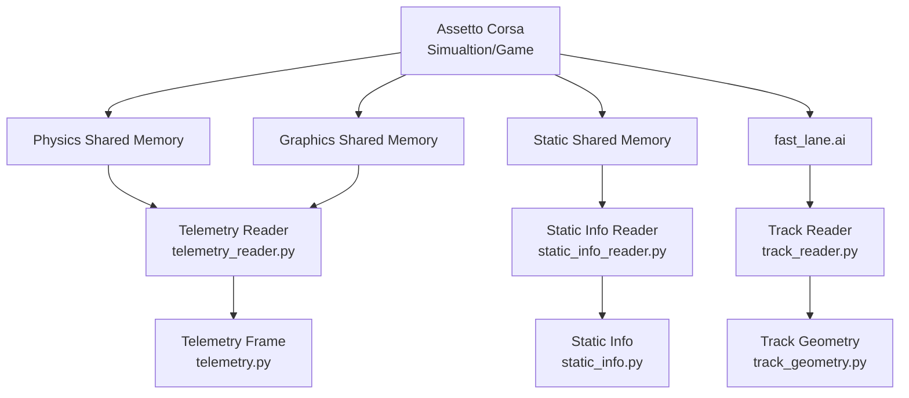

# Software Architecture

## Overview

The project separates simulator-specific Assetto Corsa integration
from simulator-independent driving and reinforcement learning logic.

The current architecture consists of three main Assetto Corsa data sources:

1. Physics shared memory
2. Graphics shared memory
3. Static shared memory
4. Track geometry is additionally extracted from Assetto Corsa's
`fast_lane.ai` spline files.


## Architecture Overview




### Coordinate Systems

All internal geometry and telemetry use Assetto Corsa's native world
coordinates:

```text
(x, y, z)
```

Readers, data models, and geometry logic do not swap or negate axes. This
applies to vehicle positions, spline positions, forward vectors, surface
normals, track boundaries, and future geometry calculations.

Coordinate transformations occur only explicitly at system boundaries.
