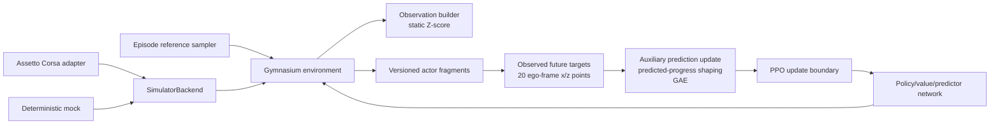

# Architecture

The package is organised around a one-way dependency flow. Assetto Corsa I/O
is an outer adapter; it is not imported by feature, reward, model or training
modules.

## Module responsibilities

`envs`
: Owns Gymnasium semantics and the black-box `SimulatorBackend` contract. A
  backend receives absolute pedal/steering values and returns synchronised,
  typed telemetry whose progress coordinate is already projected onto the
  reference. The environment owns wrap-safe progress differencing,
  delta-action integration, step-level reward and time-limit truncation.

`features`
: Contains pure observation assembly and immutable Z-score normalisation.
  Demonstration statistics are fitted offline and never updated from RL
  rollouts.

`references`
: Supplies the prescribed reference line. The initial variant always uses the
  same `FixedReferenceSampler`; `ProbabilisticMovementPrimitive` fits an RBF
  weight distribution only for a later named contextual experiment.

`rewards`
: Separates immediately available progress/safety terms from predicted
  reference-projected trajectory terms. Prediction shaping is intentionally
  applied to a completed rollout before advantage estimation.

`models`
: Implements a shared feature extractor and independent policy, value and
  trajectory-prediction heads. It has no environment or simulator dependency.

`training`
: Defines policy-versioned on-policy fragments, supervised warm-start losses
  and checkpoint persistence. It also constructs future-position targets
  without crossing episode boundaries. The executable baseline is a
  synchronous clipped-PPO learner with termination-aware GAE and an auxiliary
  predictor update. A multiprocessing runtime remains replaceable.

## Future hybrid asynchronous runtime

The thesis architecture can be added without changing environment or model
APIs:

1. each CPU actor owns one backend and emits fixed-length
   `TrajectoryFragment`s;
2. a central inference server micro-batches observations;
3. `OnPolicyCollector` rejects fragments whose policy version is stale;
4. actors pause once the target rollout is collected;
5. predictor training, predicted-progress reward shaping, GAE and PPO run
   synchronously;
6. the new policy version is broadcast before actors resume.

This is hybrid asynchronous collection, not continuously asynchronous
off-policy learning.

## Dependency rule

Domain types and configuration are leaves. Learning code may depend on them,
but simulator adapters may not be imported by learning modules. New backends
must conform to `SimulatorBackend`; new algorithms consume `RolloutBatch`.
