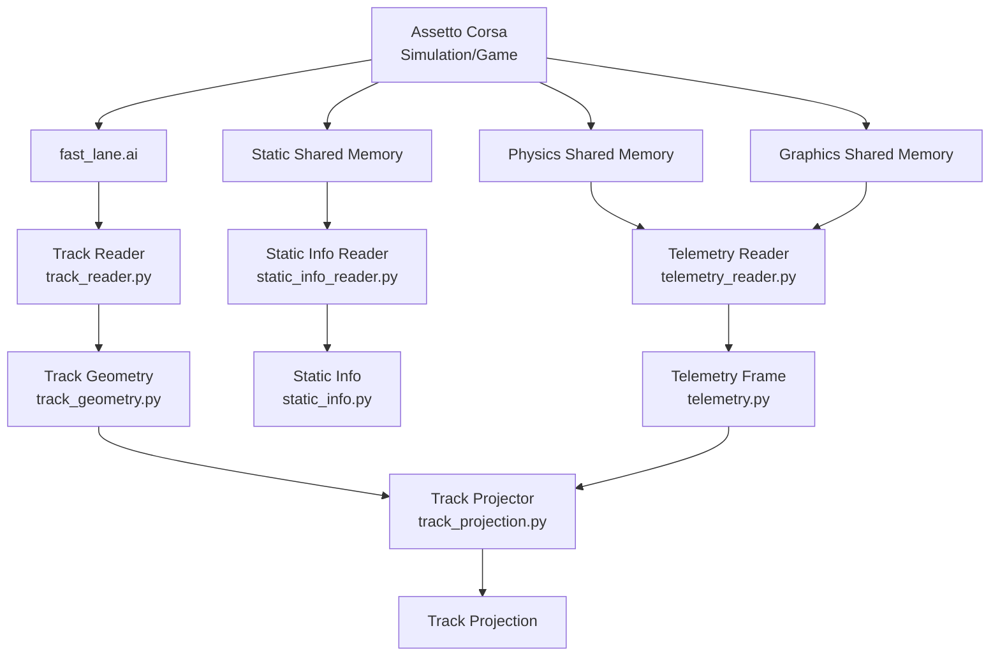

# Software Architecture

## Overview

The project separates Assetto Corsa integration from simulator-independent
geometry and future reinforcement learning logic.

The current scope covers telemetry, static information, track geometry and
vehicle position projection. Vehicle control, features, rewards and training
will be added incrementally.

## Architecture Overview

## Component Responsibilities

Readers in `src/assetto_corsa_ai/assetto_corsa/` handle simulator-specific
shared memory and file formats. They convert these sources into the general
data models `TelemetryFrame`, `SimulatorStaticInfo` and `TrackGeometry`.

[`TrackProjector`](../src/assetto_corsa_ai/track_projection.py) projects a
vehicle position onto the nearest segment of the AI spline. Its
`TrackProjection` result describes progress, lateral offset and margins to
both track edges. The AI spline is the reference line and need not be the
road centre. Lateral offset is positive to the left in spline sample order;
negative edge margins indicate a position beyond that edge.

The projector depends only on track geometry and a world position. It can
be tested without Assetto Corsa and reused by future feature calculations.

## Coordinates and Visualization

Telemetry and geometry retain Assetto Corsa's native world coordinates
`(x, y, z)`. Projection operates in 3D; coordinate transformations belong
at explicit system boundaries.

[`tools/validate_track_alignment.py`](../tools/validate_track_alignment.py)
visually compares the vehicle position with its spline projection and
displays progress and edge margins. Its zoomed X/Z view follows the vehicle,
with the vehicle's front always pointing up.

Translation and rotation affect only the display. They do not change
telemetry, track geometry or projection results. Implementation details and
configuration are documented in the respective source files.
