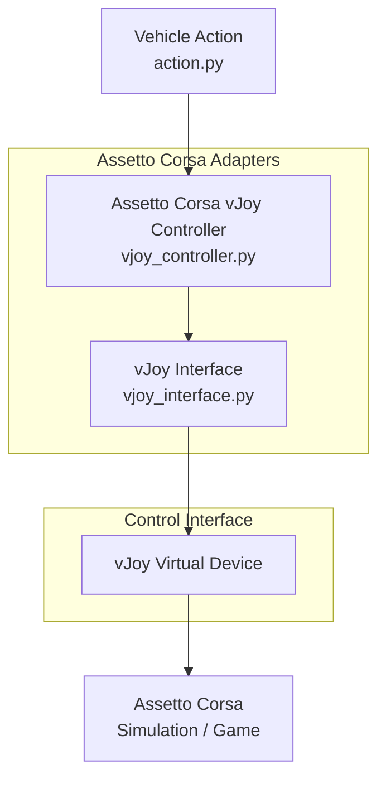

# Output / Control Layer

The output layer converts normalized vehicle actions into simulator-specific
controller inputs and sends them to Assetto Corsa. 
Therefore a virtual vJoy device is used (https://sourceforge.net/projects/vjoystick/)



## Component Responsibilities

### Domain Data

Simulator-independent representation of a vehicle control command.

- **[`VehicleAction`](../src/assetto_corsa_ai/action.py)**  
  Defines normalized steering, throttle and brake commands.

### Assetto Corsa Adapters

Translate normalized vehicle actions into Assetto Corsa specific controller inputs.

- **[`AssettoCorsaVJoyController`](../src/assetto_corsa_ai/assetto_corsa/vjoy_controller.py)**  
  Maps `VehicleAction` values to the corresponding vJoy axes.

- **[`VJoyInterface`](../src/assetto_corsa_ai/assetto_corsa/vjoy_interface.py)**  
  Provides low-level access to the vJoy driver and virtual device.

### Control Interface

- **vJoy Virtual Device**  
  Exposes the generated steering, throttle and brake inputs as a virtual controller to Assetto Corsa.

## Input Mapping

The normalized action ranges are:

| Action | Range | vJoy axis |
|---|---:|---|
| Steering | `[-1.0, 1.0]` | X |
| Throttle | `[0.0, 1.0]` | Y |
| Brake | `[0.0, 1.0]` | Z |

For RL training, the simulator input configuration should remain as linear as possible. Gamma, filters and dead zones are therefore kept neutral where possible.

## Assetto Corsa configuration

The vJoy device is configured as a wheel controller in Assetto Corsa.
For RL training, the input mapping should remain as linear as possible.
For a linear input mapping:

- Steering Gamma: `1.0`
- Steering Filter: `0`
- Steering Speed Sensitivity: `0`
- Brake Gamma: `1.0`

These settings avoid additional nonlinear input transformations and make the
simulator response easier to interpret and reproduce.

Automatic clutch and automatic shifting are enabled during the initial
development phase.

## Steering Range

The steering mapping depends on the relation between the configured virtual wheel range and the steering range of the selected vehicle.

The required steering range is vehicle-dependent.

For the current development vehicle, the virtual wheel range is configured to `640°`, which results in an approximately linear mapping over the full normalized steering range:

```text
-1.0 → full steering left
 0.0 → centered
+1.0 → full steering right
```

A different vehicle may require a different wheel range.
For now, this value is configured manually in Assetto Corsa / Content Manager.
In the future, the vehicle steering range could be read from the vehicle specifications and used by the controller to automatically scale the steering command. This would allow the normalized VehicleAction.steering range to remain [-1.0, 1.0] independently of the selected vehicle.