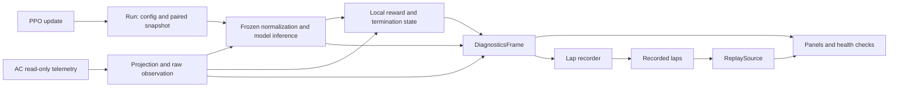

# Diagnostics Monitor

The desktop monitor reads Assetto Corsa telemetry independently and computes
observations, predictor output and rewards using the existing core classes.
It never sends controls or resets the simulator. Training and diagnostics use
separate instances; their only connection is the run directory.

## Start

Install the optional GUI dependencies and start from the project root:

```powershell
python -m pip install -e ".[diagnostics]"
python tools/diagnostics_monitor.py
```

The monitor follows the newest run under `runs/`. **Select Run**, or
`--run runs/<run_name>`, selects a specific run. `--config configs/training.toml`
provides settings before a run exists. Without a model, telemetry, track
geometry, raw observations and local step rewards remain available.
Training does not require the GUI dependencies.

## Independent calculations



[LiveSource](../tools/diagnostics/sources.py) reuses the telemetry
readers, track projection and observation builder. [Checkpoint inference](../tools/diagnostics/model.py)
loads `model.zip` with its `vecnormalize.pkl`, freezes normalization statistics
and runs the policy mean and predictor under `torch.no_grad()`.

`[diagnostics].enabled = true` in [training.toml](../configs/training.toml)
requests a snapshot after each completed PPO phase. The [snapshot writer](../src/assetto_corsa_ai/training_snapshots.py)
freezes the pair in RAM and writes it in the background. [TrainingRun](../src/assetto_corsa_ai/training_run.py)
publishes an atomic pointer only after both files are complete. `latest/` is a
rotating cache of two versions; regular checkpoints keep their configured cadence
and remain immutable. The monitor polls once per second and retains its last
good version on read failure. Slow I/O can delay or skip intermediate versions;
freezing the pair adds work at the training update boundary.

[DiagnosticsState](../tools/diagnostics/state.py) owns its reward
and termination history. Teleports, telemetry gaps, restarted counters and
cleared damage infer resets. Rewards and episode boundaries are **local
reconstructions**: sampling times and the loaded model version can differ from
training. The action panel shows observed AC controls and the checkpoint's
policy mean. Original PPO samples, advantages and training losses are unavailable
live; training metrics remain in `metrics.csv`.

Reading, inference and recording run in the [worker](../tools/diagnostics/ui/worker.py).
Qt renders at 20 Hz with bounded history. Missing, stale or invalid data appears
in the panels and [health checks](../tools/diagnostics/checks.py).

## Recording and replay

**Start / Stop Lap Recording** creates a unique directory under `recordings/`
with metadata and `lap_001.npz`, etc. Recording waits for a forward start/finish
crossing and saves complete valid laps. Resets, offtrack, episode endings, gaps
and incomplete laps are discarded with their reason recorded.

Choose **REPLAY → Open Recording**, or start with `--recording recordings/<folder>`.
Select a lap, scrub the timeline, step through frames or play at 1x, 2x or 5x.
**View → Replay lap analysis** shows statistics and plots against track progress;
no simulator is needed. [Replay calculations](../tools/diagnostics/recording.py)
derive actual future trajectories from recorded poses using the predictor's
coordinates and horizons. Futures across gaps or resets remain unavailable.
Reward sums describe recorded samples, rather than every PPO transition.
