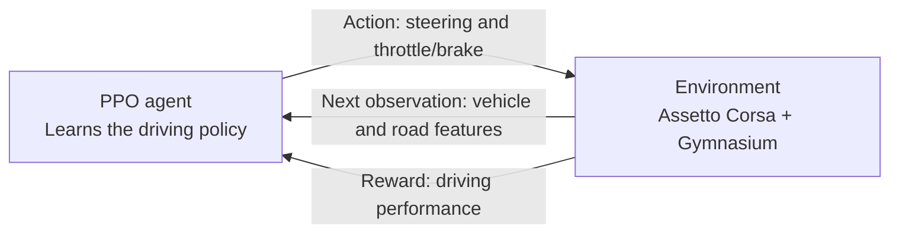

# Assetto Corsa RL

A driver that learns from the car and the road. This project uses reinforcement
learning to develop continuous steering and throttle/brake control in Assetto
Corsa, combining vehicle dynamics, track awareness and learned trajectory
prediction in a reproducible training platform.

## Learning with PPO

The agent uses **Proximal Policy Optimization (PPO)**. It supports continuous
actions, and its clipped learning objective discourages overly large policy
changes during training. This makes it a practical baseline for learning vehicle
control. The project builds on the
[Stable-Baselines3 implementation](https://stable-baselines3.readthedocs.io/en/master/modules/ppo.html)
and extends its shared neural network with an auxiliary trajectory predictor.

## System overview

The project follows the classic reinforcement learning loop: the agent acts,
the simulator advances, and the environment returns an observation and reward.
Collected experience is then used to improve the driving policy.

The current training template uses a **BMW Z4 GT3 at Monza** with a **50 ms**
control interval. The policy changes existing controls incrementally. An
auxiliary predictor estimates ten future vehicle positions up to one second
ahead. These are [configuration choices](configuration.md), not fixed platform limits.

## What the agent observes

The policy receives compact numerical features describing the car and the
road ahead:

| Feature group | Information |
| --- | --- |
| Vehicle motion | Speed, longitudinal/lateral acceleration and yaw rate |
| Tyre dynamics | Front/rear slip ratios and slip angles |
| Track awareness | Upcoming road boundaries and reference-line waypoints in vehicle-relative coordinates |
| Applied controls | Current steering and combined throttle/brake input |

[Observation details](observation.md) explain the features and their units.

## What the rewards encourage

The reward follows a simple idea:

$$
\text{reward} = \text{progress} + \text{line following} - \text{failure penalties}.
$$

- **Make progress:** move forward along the track.
- **Follow the line:** stay close to the reference line.
- **Avoid failures:** leaving the track or making too little forward progress
  ends the episode with a penalty.

Configurable weights balance these goals. The
[reward guide](reward.md#step-reward-in-equations) explains the formulas,
thresholds and optional prediction rewards.

## Learning to anticipate motion

Alongside the policy and value estimate, the **predictor learns future vehicle
positions from actual driving experience**. It shares the policy's feature
extractor, adding a supervised learning task to PPO. Optionally, predicted
progress and reference-line proximity also contribute to the reward.
[Explore the predictor](predictor.md).

## Explore the project

| Capability | Continue here |
| --- | --- |
| Simulator integration and the driving loop | [Architecture](architecture.md), [a training step](training_step.md) |
| Reproducible training, checkpoints and evaluation | [Getting started](getting_started.md), [configuration](configuration.md), [training guide](agent_training.md) |
| Live monitoring, lap recording and replay | [Diagnostics](diagnostics.md) |
| Python components and extension points | [API reference](reference/index.md), [documentation guide](documentation.md) |

## Current limitations

Automated tests use synthetic data and simulator mocks, including short PPO
updates and checkpoint restoration. Successful autonomous driving and predictor
accuracy still require evaluation with real driving data.

Live operation requires Windows, Assetto Corsa and CSP. Rolling starts are
disabled in the template; spline speed units and pre-roll behavior need to be
validated for the selected setup. Strong collisions can be supplied as an
episode termination signal, but the default factories do not yet connect a
damage detector.

The diagnostics monitor reconstructs rewards independently. Sampling times and
model versions can differ from training, so its values are not exact copies of
the training metrics.
