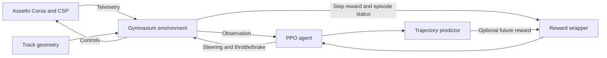

# Assetto Corsa RL

This project builds a driver that learns to control a car in Assetto Corsa
through reinforcement learning. The agent observes the vehicle and the road,
chooses steering and throttle/brake inputs, and receives rewards for its driving.
PPO improves those decisions using the experience collected in the simulator.

The project provides a modular training platform with separate responsibilities
for simulator integration, driving-state calculations and neural-network learning.

## System overview

The current training template uses a **BMW Z4 GT3 at Monza** with a **50 ms**
control interval. The policy changes existing controls incrementally. An
auxiliary predictor estimates ten future vehicle positions up to one second
ahead. These are [configuration choices](configuration.md), not fixed platform limits.

## Where to start

| I want to… | Read |
| --- | --- |
| Understand the system | [Architecture](architecture.md) and [a training step](training_step.md) |
| Run the project locally | [Getting started](getting_started.md) |
| Set up an experiment | [Configuration](configuration.md) |
| Train, resume or evaluate a model | [Training and evaluation](agent_training.md) |
| Inspect driving data | [Diagnostics and replay](diagnostics.md) |
| Look up a class or method | [Generated API reference](reference/index.md) |
| Improve these docs | [Documentation guide](documentation.md) |

## Implemented capabilities

| Area | Available behavior |
| --- | --- |
| Simulator | Shared-memory telemetry, CSP controls and session management |
| Environment | Gymnasium interface, sampled track starts, resets and optional rolling starts |
| Driving state | Vehicle and tyre dynamics, track boundaries and reference waypoints |
| Learning | PPO with a shared feature extractor for policy, value and predictor heads |
| Reward | Progress, reference-line proximity, termination penalties and optional prediction rewards |
| Experiments | Archived configuration, provenance, metrics and paired model/normalization checkpoints |
| Analysis | Independent live monitor, complete-lap recording and replay |

## Current limitations

Automated tests use synthetic data and simulator mocks, including short PPO
updates and checkpoint restoration. Successful autonomous driving and predictor
accuracy still require evaluation with real driving data.

Live operation requires Windows, Assetto Corsa and CSP. Rolling starts are
disabled in the template; spline speed units and pre-roll behavior need to be
validated for the selected setup. Strong collisions can be supplied as an
episode termination signal, but the default factories do not yet connect a
damage detector.

The diagnostics monitor reconstructs rewards independently. Sampling times and
model versions can differ from training, so its values are not exact copies of
the training metrics.
