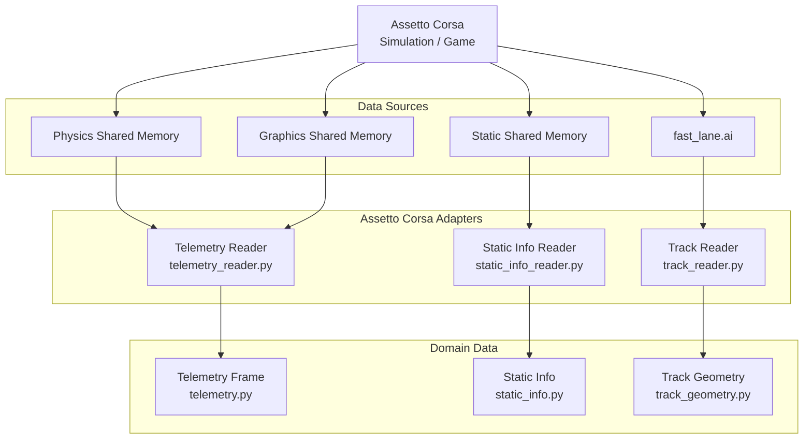

## Input/Read Layer

### Data Sources

Provide raw simulator and track data.

- **Physics Shared Memory**  
  Runtime vehicle physics such as speed, steering, throttle, brake, acceleration and wheel data.

- **Graphics Shared Memory**  
  Runtime session and vehicle position information.

- **Static Shared Memory**  
  Simulator and vehicle metadata that remains mostly constant during a session.

- **`fast_lane.ai`**  
  Track geometry source used to reconstruct the reference spline and track boundaries.

### Assetto Corsa Adapters

Translate Assetto Corsa specific data formats into internal project models.

- **[`TelemetryReader`](../src/assetto_corsa_ai/assetto_corsa/telemetry_reader.py)**  
  Reads physics and graphics shared memory and creates a `TelemetryFrame`.

- **[`StaticInfoReader`](../src/assetto_corsa_ai/assetto_corsa/static_info_reader.py)**  
  Reads static shared memory and creates `StaticInfo`.

- **[`TrackReader`](../src/assetto_corsa_ai/assetto_corsa/track_reader.py)**  
  Parses `fast_lane.ai` and creates `TrackGeometry`.

### Domain Data

Simulator-independent representations used by the rest of the application.

- **[`TelemetryFrame`](../src/assetto_corsa_ai/telemetry.py)**  
  Represents the current vehicle state.

- **[`StaticInfo`](../src/assetto_corsa_ai/static_info.py)**  
  Contains vehicle, track and simulator metadata.

- **[`TrackGeometry`](../src/assetto_corsa_ai/track_geometry.py)**  
  Represents the sampled track geometry including centerline and boundaries.
   
