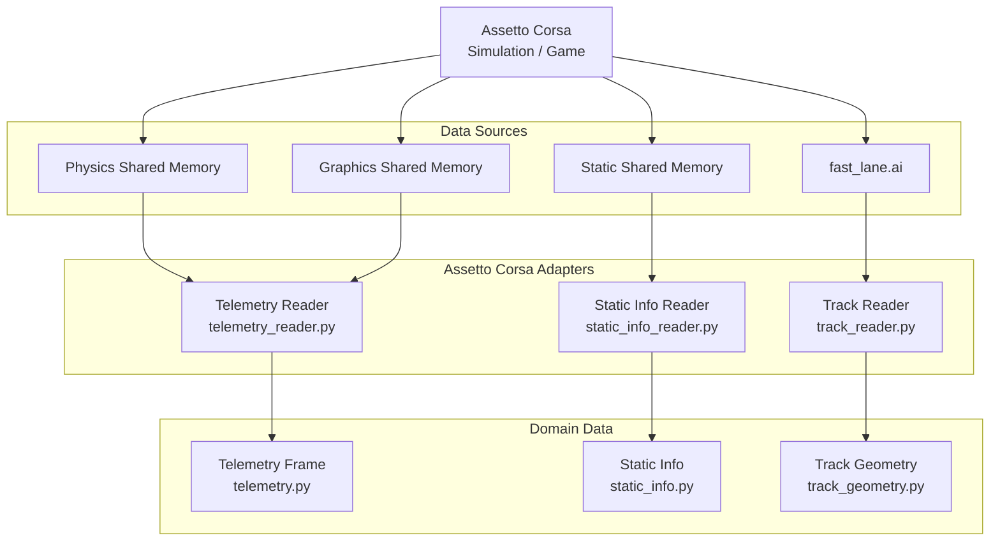

# Input / Read Layer

The AC adapters translate shared-memory pages and track files into typed domain
data. Observations, geometry and reward calculations consume those models
without parsing simulator formats themselves.

## Data Sources and Adapters

| Source | Purpose | Adapter |
| --- | --- | --- |
| Physics and graphics shared memory | Runtime vehicle state and world position. | [TelemetryReader](../src/assetto_corsa_ai/assetto_corsa/telemetry_reader.py) |
| Static shared memory | Vehicle, track and session metadata. | [StaticInfoReader](../src/assetto_corsa_ai/assetto_corsa/static_info_reader.py) |
| `fast_lane.ai` | Sampled reference line and track widths. | [AssettoCorsaTrackReader](../src/assetto_corsa_ai/assetto_corsa/track_reader.py) |

## Domain Data

[TelemetryFrame](../src/assetto_corsa_ai/telemetry.py) represents the current
vehicle state. [SimulatorStaticInfo](../src/assetto_corsa_ai/static_info.py)
holds session metadata. [TrackGeometry](../src/assetto_corsa_ai/track_geometry.py)
stores the sampled reference line and boundary information.

Memory layouts, field mappings and file parsing remain in the linked adapters.
[TrackProjector](../src/assetto_corsa_ai/track_projection.py) derives progress
and lateral offset from geometry; [observation construction](observation.md)
then combines vehicle and track features.
