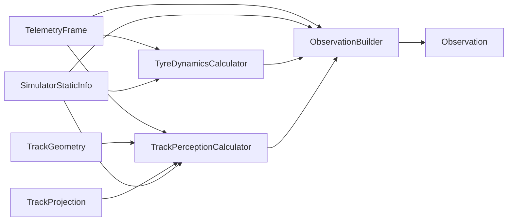

# Observation Features

[ObservationBuilder](../src/assetto_corsa_ai/observation_builder.py) combines
vehicle dynamics, upcoming road geometry, reference waypoints and current
controls into an [Observation](../src/assetto_corsa_ai/observation.py).

## Feature Groups

| Group | Contents | Calculation |
| --- | --- | --- |
| Vehicle state | Speed in m/s, longitudinal/lateral acceleration in g and yaw rate in rad/s. | [ObservationBuilder](../src/assetto_corsa_ai/observation_builder.py) |
| Tyre dynamics | Front/rear axle slip ratios and slip angles in radians. | [TyreDynamicsCalculator](../src/assetto_corsa_ai/tyre_dynamics.py) |
| Track perception | Left/right boundary points and reference waypoints in local metres. | [TrackPerceptionCalculator](../src/assetto_corsa_ai/track_perception.py) |
| Current controls | Steering and combined longitudinal input (`throttle - brake`). | [ObservationBuilder](../src/assetto_corsa_ai/observation_builder.py) |

## Coordinates and Agent Input

Track points use `(forward, left)`: positive forward is ahead, positive left
is to the vehicle's left. Reference waypoints follow the sampled
`fast_lane.ai` line; boundary points use its stored widths. Lookahead and
reference sampling distances come from
[the environment configuration](../configs/training.toml).

[Observation.to_array()](../src/assetto_corsa_ai/observation.py) fixes the
flattened `float32` ordering, with the two controls last. The
[environment](racing_environment.md) returns raw values and validates their
size; [agent-side normalization](../src/assetto_corsa_ai/racing_policy.py)
prepares network input while retaining control units in delta-action mode.

The reference waypoints describe the road ahead. The
[auxiliary predictor](predictor.md) separately learns the vehicle's future
trajectory. Individual formulas, sign conventions and interpolation details
remain in the linked calculators.
