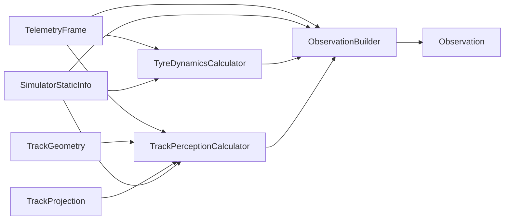

# Observation Features

The observation combines vehicle dynamics, track geometry, reference trajectory
information, and the currently applied controls.

## 1. Vehicle State

The vehicle-state features describe the current dynamic state of the car.

| Feature | Description | Unit |
| --- | --- | --- |
| `speed` | Absolute vehicle speed. Provides the agent with the current magnitude of vehicle motion. | m/s |
| `longitudinal_acceleration` | Acceleration along the vehicle's longitudinal axis. Positive values indicate acceleration, negative values indicate deceleration. | g |
| `lateral_acceleration` | Acceleration perpendicular to the driving direction. Represents the lateral load generated during cornering. | g |
| `yaw_rate` | Angular velocity around the vehicle's vertical axis. Describes how quickly the vehicle rotates while cornering. | rad/s |

## 2. Tyre Dynamics

Tyre-dynamics features provide information about the current longitudinal and
lateral behaviour of the front and rear axles.

| Feature | Description | Unit |
| --- | --- | --- |
| `front_slip_ratio` | Mean longitudinal slip ratio of the front axle. Indicates the difference between tyre circumferential speed and vehicle speed. | — |
| `rear_slip_ratio` | Mean longitudinal slip ratio of the rear axle. Useful for detecting wheel spin or braking slip. | — |
| `front_slip_angle` | Lateral velocity angle evaluated at the front axle centre. Describes lateral motion of the front axle relative to the vehicle heading. | rad |
| `rear_slip_angle` | Lateral velocity angle evaluated at the rear axle centre. Describes lateral motion of the rear axle relative to the vehicle heading. | rad |

The axle-level representation keeps the observation compact while still
providing the agent with information about vehicle stability and tyre behaviour.

## 3. Track Perception

Track-perception features describe the road geometry ahead of the vehicle.
All points are transformed from Assetto Corsa world coordinates into the
vehicle coordinate system.

Each point is represented as:

```text
(forward_distance, left_distance)
```

- `forward_distance > 0`: point is ahead of the vehicle.
- `left_distance > 0`: point is left of the vehicle.
- `left_distance < 0`: point is right of the vehicle.

### Track Boundaries

Track perception describes the upcoming track geometry using vehicle-relative coordinates. Each boundary and reference point is represented as (forward, left) in meters.
The left and right track limits are sampled at seven lookahead distances:

```text
5, 10, 20, 40, 80, 160, 320 m
```

| Feature | Description |
| --- | --- |
| `left_boundary` | Seven points describing the upcoming left track boundary. |
| `right_boundary` | Seven points describing the upcoming right track boundary. |

The increasing spacing provides high resolution close to the vehicle while
still giving the agent information about the longer-term track geometry.

### Reference Trajectory

The reference trajectory gives the agent information about a desirable path
through the upcoming section of track. The current implementation uses the
centre positions stored in the `fast_lane.ai` spline as the reference trajectory.

Twenty waypoints are sampled at:

```text
5, 10, 15, ..., 100 m
```

and transformed into vehicle-relative coordinates.

| Feature | Description |
| --- | --- |
| `reference_waypoints` | Twenty upcoming points describing the reference trajectory ahead of the vehicle. |

The reference trajectory is conceptually separate from `TrackGeometry`.
Using `fast_lane.ai` as the reference line is the current implementation and
can later be replaced by a dedicated optimized trajectory without changing
the observation interface.

## 4. Current Controls

The current controls provide the agent with information about the control state
currently applied to the vehicle.

| Feature | Description | Range |
| --- | --- | --- |
| `steering` | Current steering state. Negative and positive values represent steering in opposite directions. | Approximately `[-1, 1]` |
| `longitudinal_control` | Combined throttle and brake state. Positive values represent throttle and negative values represent braking. | `[-1, 1]` |

The longitudinal control is defined as:

```text
longitudinal_control = throttle - brake

-1.0 = full brake
 0.0 = coast
+1.0 = full throttle
```

## Observation Overview


