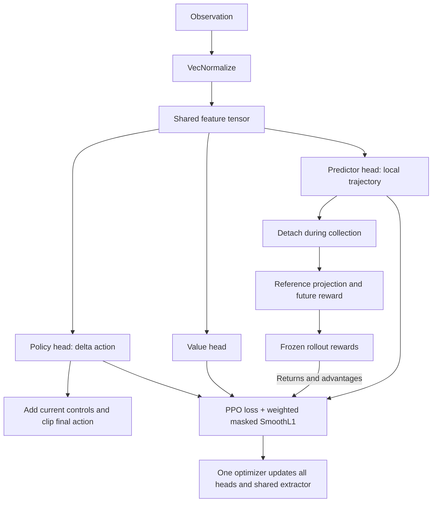

# Auxiliary Trajectory Predictor

The predictor estimates future vehicle positions in local `(forward, left)`
metres relative to the observation's pose. [The run config](../configs/training.toml)
sets head sizes, horizons and loss weight. The template predicts ten points
from 0.1 to 1.0 seconds.

## Shared Model and Training



[RacingActorCriticPolicy](../src/assetto_corsa_ai/racing_policy.py) evaluates
policy, value and predictor from the same feature tensor.
[RacingPPO](../src/assetto_corsa_ai/racing_ppo.py) adds masked SmoothL1 supervision
to PPO using the same optimizer. The predictor head learns through this
supervised loss; the shared extractor also receives PPO gradients.

Targets use actual future poses from the current rollout, transformed into
the originating vehicle frame. Each horizon has its own validity mask:
missing future points and points beyond episode boundaries are excluded,
while shorter valid horizons still train. Horizon indices use the nominal
control grid. Target transforms and loss are defined in
[predictor.py](../src/assetto_corsa_ai/predictor.py).

All heads and optimizer state are saved together with the
[training run's paired normalization snapshot](agent_training.md).

## Reward Boundary

[PPOAgent.predict_trajectory()](../src/assetto_corsa_ai/agent.py) returns detached
local points for inspection. During collection, the action's shared features
also produce one detached snapshot for the optional
[future reward wrapper](../src/assetto_corsa_ai/reward_wrapper.py).
It projects predicted points onto the active reference line and adds
[look-ahead reward](reward.md) before monitoring and normalization.
Actual future poses remain supervised targets only; stored rewards stay
fixed throughout PPO updates.

## Validation

[validate_predictor.py](../tools/validation/validate_predictor.py) compares predictions
with test/selected trajectories and prints errors, reference projections,
per-horizon reward contributions and the total reward:

```powershell
# Fresh, untrained model on synthetic data; inspect the full reward weight.
python tools/validate.py predictor --training-step 50000 --plot

# Saved model with its own config and normalization.
python tools/validate.py predictor --checkpoint runs/<run_name>/final --plot
```

Selected NPZ data requires its matching `--reference-line fast_lane.ai`.
Data format, sample selection and plot export are documented in the tool.
No simulator process is started. Synthetic tests establish integration
correctness; prediction accuracy still needs validation on real driving data.
