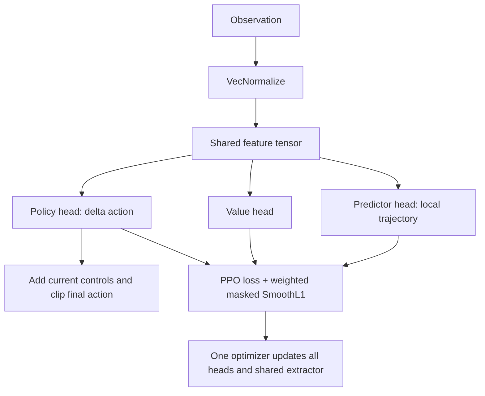

# Auxiliary trajectory predictor

The predictor learns future positions in metres, expressed as `(forward, left)`
relative to the vehicle pose at the observation. Horizon times, head sizes and
loss weight come from `[predictor]` in the run's TOML; the template predicts
10 points from 0.1 to 1.0 seconds.



`RacingPPO` extends SB3 collection with pose recording and its PPO update with
the auxiliary loss. SB3 still owns rollouts, GAE, clipping and serialization.
Targets use only the current rollout. Each horizon has a mask: missing future
steps and points beyond an episode end are excluded, while shorter valid
horizons still train. The actual terminal endpoint is usable; the auto-reset
pose belongs to a different episode. Horizons must match the configured
control grid; timings currently use nominal control steps.

`RacingActorCriticPolicy` evaluates all three heads from the same feature
tensor. All weights and the common optimizer state live in `model.zip`;
matching normalization statistics remain in `vecnormalize.pkl`.
`PPOAgent.predict_trajectory(raw_observation)` returns detached local points
for inspection or a later reward calculator. `[reward.future_prediction]`
remains disabled; both existing prediction reward fields stay `0.0`.

```powershell
# Test data and a fresh, untrained model; checks plumbing, not learned accuracy.
python tools/validate_predictor.py --plot

# Inspect a trained run using its own config and normalization.
python tools/validate_predictor.py --checkpoint runs/<run_name>/final --plot
```

`--data selected.npz` accepts raw `observations` shaped `(steps, envs, features)`,
`vehicle_positions`, `vehicle_forwards` and `next_vehicle_positions` shaped
`(steps, envs, 3)`, and boolean `episode_ends` shaped `(steps, envs)`.
Endpoint positions must precede auto-reset. `--sample` selects a starting step;
the tool inspects environment 0 and prints predictions, targets, coordinate
errors and masked loss. `--save-plot trajectory.png` exports the comparison.
No rollout data is saved automatically. Game-free tests cover geometry,
masking, shared gradients, short PPO training and checkpoint restoration;
prediction accuracy still needs validation on real driving data.
