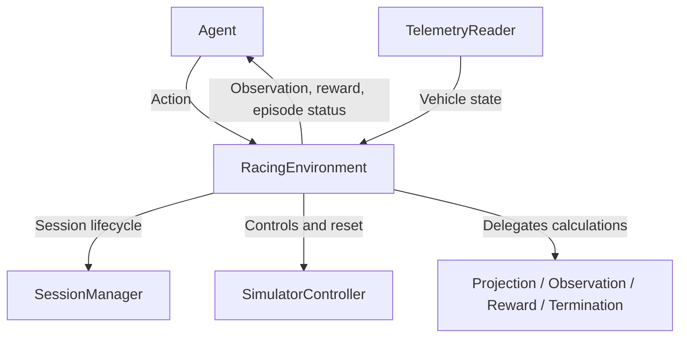

# Racing Environment

[RacingEnvironment](../src/assetto_corsa_ai/RacingEnvironment.py) provides the
Gymnasium boundary between agent and simulator. It coordinates the
[session manager](session_manager.md), [controller](control.md), telemetry and
the observation, reward and termination components.



## Agent Interface

| Interface | Representation |
| --- | --- |
| Action | Final `[steering, longitudinal]` controls in `[-1, 1]`; positive longitudinal input means throttle, negative means brake. |
| Observation | Flat `float32` vector from [Observation.to_array()](../src/assetto_corsa_ai/observation.py), retaining physical units. |
| Reset | `reset(seed=None, options=None)` returns `(observation, info)`. |
| Step | `step(action)` returns `(observation, reward, terminated, truncated, info)`. |
| Close | `close()` releases runtime resources and stops the managed session by default. |

Actions and observations are checked for shape and finite values; actions
outside the range raise an error. Spaces exist before reset and observation
size stays fixed. [The agent](../src/assetto_corsa_ai/agent.py) handles delta
actions, normalization and the optional prediction reward wrapper.
Its [action filter](../src/assetto_corsa_ai/action_wrapper.py) constrains executed
deltas without changing the base environment's final-control interface.

Reset/step `info` supplies the reference projection and vehicle pose for
external calculations. The base environment evaluates actual step reward
and contains no neural-network or predictor logic.

## Episodes

Reset reuses an unchanged session and teleports to the episode start.
The first observation waits for neutral controls in telemetry so CSP's
reset brake cannot become the delta policy's initial control baseline.
Seeded samplers select scenario/start, which `options` can override.
Each step applies [mapped controls](../src/assetto_corsa_ai/action.py), waits
for the control interval, reads telemetry and delegates to
[projection](../src/assetto_corsa_ai/track_projection.py),
[observation building](../src/assetto_corsa_ai/observation_builder.py),
[reward](reward.md) and [termination](termination.md).

Optional rolling starts use [StartConfig](../src/assetto_corsa_ai/episode_start.py)
to sample 30–60% of the local AI-line speed, with configurable absolute limits.
The [pre-roll controller](../src/assetto_corsa_ai/reset_preroll.py) teleports
upstream and follows the line until pose and speed meet the reset tolerances.
Pre-roll produces no RL transitions; progress, timing and termination state
start at handoff, retaining the applied controls in the first observation.
Failed attempts are bounded; explicitly supplied starts are never resampled.

`[start]` in the training TOML contains the controller settings. Rolling starts
are disabled until the raw spline speed unit has been validated; set
`reference_speed_unit` to `"kmh"` or `"mps"` before enabling them. Archived
configs without `[start]` retain stationary resets. Validate a configured reset
without PPO using `python tools/validate_racing_environment.py --config configs/training.toml --steps 0`.

In the run config, `max_episode_time = 0` and `max_episode_steps = 0`
disable their respective limits.

Domain failures set `terminated`; time or step limits set `truncated`.
Either ends the episode and applies the brake until reset. Step errors also
invalidate the episode. Timing, readiness checks and cleanup are documented
in [the environment source](../src/assetto_corsa_ai/RacingEnvironment.py).

## Validation

Close AC and run [the live validator](../tools/validate_racing_environment.py)
from the project virtual environment:

```powershell
python tools/validate_racing_environment.py --check-env --steps 10 --action 0 0.15
```

The default factory launches BMW Z4 GT3 at Monza. Enter Drive/Start, leave the
car stationary and confirm in the terminal. Validation captures this pose
and reuses it for resets; training instead samples track starts.

The tool runs SB3's `check_env()` and a reset/step sequence with sampled or
specified actions. Exiting stops the managed session; `--keep-session`
leaves AC open. Overrides and custom factories are described in the linked
tool. See [training runs](agent_training.md) for PPO execution and checkpoints.
