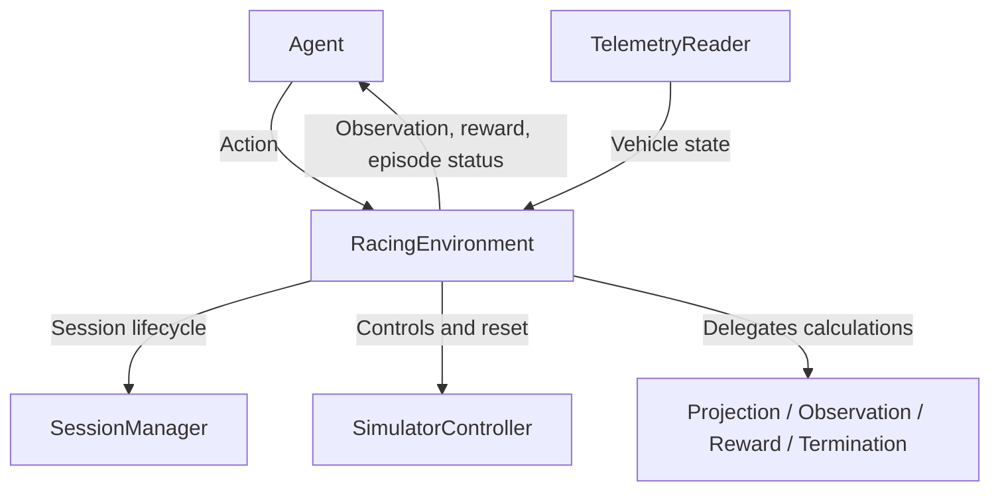

# Racing Environment

[`RacingEnvironment`](../src/assetto_corsa_ai/RacingEnvironment.py) is the
Gymnasium interface between the agent and Assetto Corsa. It coordinates the
[session manager](session_manager.md), [controller](control.md), telemetry and
the simulator-independent observation, reward and termination components.



## Agent Interface

| Interface | Representation |
| --- | --- |
| Action | Two values `[steering, longitudinal]` in `[-1, 1]`; positive longitudinal input means throttle, negative means brake. |
| Observation | Flat `float32` vector from `Observation.to_array()`, retaining physical units. See [observation features](observation.md). |
| Reset | `reset(seed=None, options=None)` returns `(observation, info)`. |
| Step | `step(action)` returns `(observation, reward, terminated, truncated, info)`. |
| Close | `close()` releases runtime resources and stops the managed session by default. |

Array-like actions are converted to `float32` before validation. Invalid shapes,
nonfinite values and values outside `[-1, 1]` raise errors; actions are not clipped.

The action and observation spaces exist before the first reset.
`observation_size` must match the configured builder and stay fixed across
scenarios. Observations are validated for shape and finite values; normalization
belongs in a separate wrapper, such as SB3's `VecNormalize`.

## Episodes

Reset reuses the session for the same car/track/layout and teleports to the
episode start. `options` can override `"scenario"` and `"start"`; otherwise the
configured samplers choose them. A seed reproduces these choices.

Each step applies controls, waits for the configured control interval and reads
telemetry. Track projection then supplies progress and lateral offset for the
[reward](reward.md), while the builder creates the next observation and the
termination checker evaluates the episode state.

`terminated` marks a domain failure, such as leaving the track or a strong
collision; `truncated` marks a time or step limit. Either ends the episode and
applies the brake until the next reset. Errors also invalidate the episode
and cancel driving.

## Validation

Close AC, then run the live validator from the project virtual environment:

```powershell
python tools/validate_racing_environment.py --check-env --steps 10 --action 0 0.15
```

The default factory (`assetto_corsa_ai.main:create_environment`) launches BMW
Z4 GT3 at Monza. Enter Drive/Start, leave the car stationary, then press Enter
in the terminal. CSP connects afterwards. Validation captures this pose and
reuses it for resets; it does not sample random spline starts.

The tool checks the reset/step results and runs SB3's `check_env()`, which also
performs resets and sampled actions. It reports progress, timing, reward and
episode status. Exiting releases controls and stops the managed session;
`--keep-session` leaves AC open.

Use `--ac-directory`, `--documents-directory`, `--car`, `--track` or `--layout`
to override the defaults. Custom `--factory module:function` callables accept
zero arguments. Automated tests exercise validation failures and cleanup with
mocked adapters; live validation remains separate from PPO training.

Further options and API details are documented in the source.

See [PPO training and driving](agent_training.md) for the executable agent,
checkpoint recovery and axle-distance configuration.
