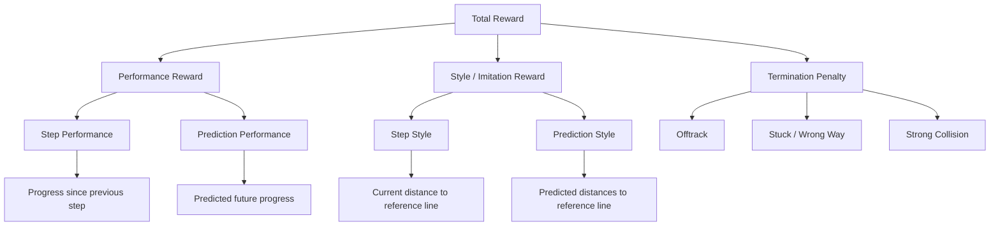

# Reward

The reward combines signed progress, proximity to the reference line and a
penalty for domain termination. Optional look-ahead terms evaluate the
[auxiliary predictor's](predictor.md) detached trajectory.

## Reward Structure



## Step Reward and Composition

[RewardCalculator](../src/assetto_corsa_ai/reward.py) keeps composition central:

```text
total = performance_step + performance_prediction
      + style_weight * (style_step + style_prediction) + termination_penalty
```

Step performance rewards signed progress in metres. The shared progress-delta
function handles forward and backward start/finish crossings. Step style uses
a Gaussian of lateral distance: it peaks on the reference line and decreases
symmetrically with distance. Termination penalties are already negative.

The returned `Reward` exposes all components separately in the environment's
`info`. [Termination detection](termination.md) supplies the reason; the
calculator supplies its penalty. Weights, style tolerance and penalties come
from `[reward]` in [config.toml](../configs/training.toml).

## Future Predictor Reward

[FuturePredictorRewardCalculator](../src/assetto_corsa_ai/future_reward.py)
transforms predicted `(forward, left)` points using the observation's vehicle
pose and projects them onto the same [reference line](../src/assetto_corsa_ai/track_projection.py).
Every horizon contributes, with nearer points receiving more weight when the
horizon discount is below one:

- Performance sums weighted progress increments, starting at the current progress.
- Style averages weighted Gaussian proximity scores using the step reward's tolerance.

Future weights scale these two terms; the outer `style_weight` still applies
to step and prediction style. `[reward.future_prediction]` controls enablement,
weights, horizon discount and warmup/ramp. Warmup holds future weights at zero;
the ramp then increases them linearly. Setting both durations to zero applies
the full configured weights immediately.
Disabling the extension leaves the step reward unchanged.

[FutureRewardWrapper](../src/assetto_corsa_ai/reward_wrapper.py) consumes one
detached prediction from the action's shared features, before Monitor and
VecNormalize. The reward is stored once during collection. Actual future poses
train the predictor through its supervised loss; they never supply future
reward, and PPO updates never recompute stored rewards.

[Training callbacks](../src/assetto_corsa_ai/training_callbacks.py) log raw
component means, weight scale and prediction diagnostics with each PPO update.
For per-point projections, contributions and total reward, use
[predictor validation](predictor.md#validation). Formula details and component
definitions remain in the linked calculators.
