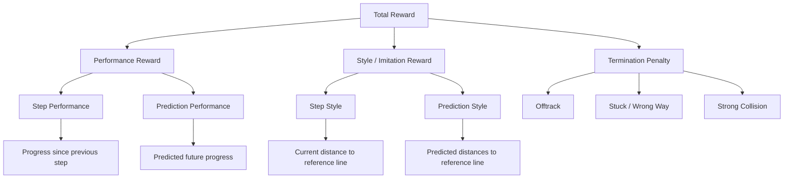

# Reward

The reward function evaluates how well the agent progresses along the track while following the reference trajectory.

The current implementation consists of:

- a **performance reward** for forward progress
- a **style imitation reward** for staying close to the reference line
- a **termination penalty** when an episode ends because of an undesirable state

Optional look-ahead terms evaluate the detached trajectory from the auxiliary predictor.

---

## Reward Structure



---

## Current Reward

The combined reward is

\[
r_t =
r_{p,t}
+
\hat r_{p,t}
+
\lambda_s (r_{s,t} + \hat r_{s,t})
+
p_{term}
\]

with:

- \(r_{p,t}\): performance reward
- \(r_{s,t}\): style imitation reward
- \(\lambda_s\): style weight
- \(p_{term}\): termination penalty

---

## 1. Performance Step Reward

The performance reward is based on the signed progress along the closed reference spline between two consecutive agent steps.

```text
delta_s = current_s - previous_s
```

Positive progress produces a positive reward, while backwards movement produces a negative reward.

Start/finish wraparound is corrected automatically so that crossing the lap boundary does not produce an artificial jump.

The reward term is:

\[
r_{p,t} = w_p \Delta s_t
\]

where:

- \(\Delta s_t\) is the signed progress in metres
- \(w_p\) is the performance weight

This term directly rewards actual progress along the reference line rather than vehicle speed alone.

---

## 2. Style Imitation Reward

The style reward encourages the vehicle to remain close to the reference trajectory.

The input is the lateral offset from the spline:

```text
lateral_offset = projection.lateral_offset
```

Only the magnitude of the offset matters, so deviations to the left and right are treated equally.

A Gaussian reward is used:

\[
r_{s,t}
=
\exp\left(
-\frac{d_t^2}{2\sigma_s^2}
\right)
\]

where:

- \(d_t\) is the lateral distance to the reference line
- \(\sigma_s\) controls how quickly the reward decreases with distance

The unweighted style score satisfies:

```text
0 < style_step <= 1
```

and reaches its maximum directly on the reference line.

Example for `style_sigma = 1.0`:

| Lateral distance | Style score |
|---:|---:|
| `0.0 m` | `1.000` |
| `0.5 m` | `0.882` |
| `1.0 m` | `0.607` |
| `2.0 m` | `0.135` |
| `3.0 m` | `0.011` |

The contribution to the total reward is weighted by `style_weight`.

---

## 3. Termination Penalty

If the current step terminates the episode, an additional penalty is added.

Current termination reasons are:

| Reason | Description |
|---|---|
| `OFF_TRACK` | At least one tyre contact point is outside the track boundaries. |
| `STUCK_OR_WRONG_WAY` | The vehicle makes insufficient net forward progress over a configurable time window. |
| `STRONG_COLLISION` | A strong collision has been detected externally. |

The exact penalty values are configurable in `RewardCalculator`.

---

## Reward Breakdown

Instead of returning only one scalar value, the implementation exposes the individual reward components:

```python
@dataclass(frozen=True)
class Reward:
    total: float

    performance_step: float
    style_step: float

    performance_prediction: float
    style_prediction: float

    termination_penalty: float
```

This makes reward tuning and training diagnostics easier because each component can be logged independently.

---

## Future Predictor Reward

`FuturePredictorRewardCalculator` transforms local `(forward, left)` points
using the observation's vehicle pose and projects them onto the same reference
line as the step reward. Every point contributes, using
`alpha_i = horizon_discount ** (i - 1)`:

```text
performance_prediction = scale * future.performance_weight * sum(alpha_i * delta_s_i)
style_prediction       = scale * future.style_weight * sum(alpha_i * q_i) / sum(alpha_i)
```

`delta_s_i` starts at the current progress and uses the existing closed-track
wraparound rule. `q_i` uses the same Gaussian and `style_sigma` as step style.
Its weighted mean lies between zero and one; the future style weight scales
that mean, and the existing outer `style_weight` applies in the combined reward.

`[reward.future_prediction]` controls enablement, both weights, discount,
`warmup_steps` and `ramp_steps`. The template uses weights `0.05`, discount
`0.95`, 20,000 warmup steps and a 30,000-step linear ramp. Disabled or warmup
terms are exactly zero; auxiliary predictor training continues throughout.

During collection, `FutureRewardWrapper` consumes one detached prediction
from the action's shared feature tensor, before Monitor and VecNormalize.
The resulting reward enters PPO once and is never recomputed during updates.
Actual later positions are auxiliary-loss targets only. Raw component means,
weight scale and prediction diagnostics are logged with each PPO update;
mean predicted progress measures cumulative advance from the current pose.
See [predictor validation](predictor.md) for per-point projections and rewards.

---

## Design Principle

The reward system remains independent of the simulator interface.

It consumes already derived quantities such as:

- signed progress
- lateral offset
- termination result

This keeps simulator-specific data handling separate from reward logic and makes the reward function easy to test.
