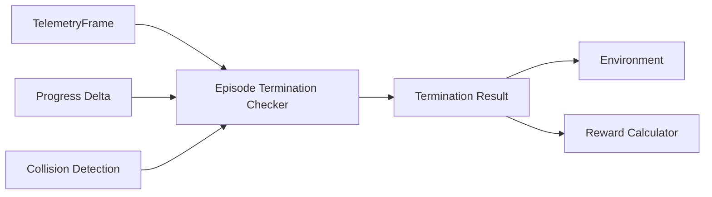

# Episode Termination

Episode termination is handled separately from reward calculation.

The termination system decides **whether an episode must end and why**.
The reward system only converts that result into the corresponding penalty.

---

## Architecture



This separation keeps termination detection independent from reward weighting.

---

## Termination Result

Termination is represented explicitly:

```python
class TerminationReason(Enum):
    OFF_TRACK = auto()
    STUCK_OR_WRONG_WAY = auto()
    STRONG_COLLISION = auto()
```

and returned as:

```python
@dataclass(frozen=True)
class TerminationResult:
    terminated: bool
    reason: TerminationReason | None
```

The environment therefore receives both:

- whether the episode ended
- the exact reason

---

## 1. Offtrack

An episode terminates when at least one tyre contact point leaves the valid track area.

```text
all four tyres inside
        ↓
episode continues

at least one tyre outside
        ↓
OFF_TRACK
```

Each tyre contact point is projected onto the track geometry using `TrackProjector`.

The projected clearances are then checked:

```text
left_clearance  < 0
or
right_clearance < 0
```

If either condition is true for any wheel, the vehicle is considered offtrack.

This definition is stricter and more physically meaningful than checking only the vehicle centre.

---

## 2. Stuck or Wrong Way

Standing still and sustained backwards driving are handled through the same progress-based condition.

The checker stores recent signed progress values:

```text
delta_s > 0  -> forward progress
delta_s = 0  -> no progress
delta_s < 0  -> backwards progress
```

Progress is accumulated over a configurable time window.

Example:

```text
stuck_time       = 4.0 s
minimum_progress = 2.0 m
```

If the vehicle achieves less than the required net forward progress during that interval, the episode terminates with:

```text
STUCK_OR_WRONG_WAY
```

This naturally handles:

- standing still
- oscillating without meaningful progress
- driving backwards for an extended period

The initial time window is ignored so that an episode cannot terminate immediately after reset.

---

## 3. Strong Collision

A strong collision also terminates the episode.

The current termination interface already supports:

```python
strong_collision: bool
```

but collision detection itself is intentionally kept outside the termination checker.

```text
Collision Detector
        ↓
strong_collision
        ↓
EpisodeTerminationChecker
```

The exact Assetto Corsa signal and threshold for reliable strong-collision detection still need to be validated before implementation.

---

## Reset Behaviour

`EpisodeTerminationChecker` is stateful because the stuck condition depends on recent progress history.

At the start of every new episode:

```python
termination_checker.reset()
```

must be called.

This clears:

- elapsed episode time used by the stuck detector
- stored progress history

---

## Evaluation Order

The current checker evaluates termination conditions in this order:

```text
1. Offtrack
2. Strong collision
3. Stuck / wrong way
```

Only one termination reason is returned for a step.

The order can be changed later if another priority is required for diagnostics.

---

## Configuration

The current configurable termination parameters are:

| Parameter | Meaning |
|---|---|
| `stuck_time` | Time window used for progress evaluation |
| `minimum_progress` | Minimum required forward progress within that window |

Reward penalties are not configured here. They belong to `RewardCalculator`.

This keeps detection and reward weighting separate.

---

## Design Principle

The termination checker answers only:

```text
Should the episode end?
Why?
```

It does not decide:

```text
How large should the penalty be?
```

That responsibility belongs to the reward system.

This separation keeps the environment easier to test, tune and extend.
