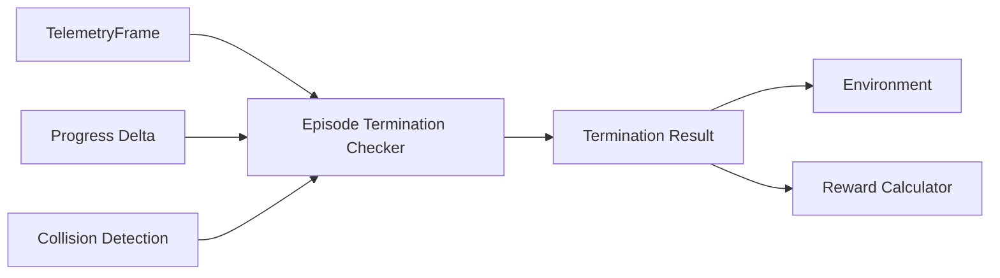

# Episode Termination

[EpisodeTerminationChecker](../src/assetto_corsa_ai/termination.py) decides
whether a domain failure ends the episode and returns its reason.
[Reward calculation](reward.md) assigns the corresponding penalty.

## Architecture

## Conditions

| Reason | Condition |
| --- | --- |
| `OFF_TRACK` | At least one tyre has a negative lateral clearance after [track projection](../src/assetto_corsa_ai/track_projection.py). |
| `STRONG_COLLISION` | An external collision detector reports a strong impact. |
| `STUCK_OR_WRONG_WAY` | Net forward progress is below the configured minimum over a time window. |

Checks run in that order; one reason is returned per step. The progress check
also catches prolonged standing still or backwards driving. Its initial time
window is allowed to fill before termination. Reset clears that history.

`[termination]` in [config.toml](../configs/training.toml) defines the time window
and minimum progress. Reward penalties belong to `[reward]`.

The [environment](../src/assetto_corsa_ai/RacingEnvironment.py) accepts an
external `strong_collision_check`; the current [default factories](../src/assetto_corsa_ai/main.py)
do not wire a damage detector. [Damage validation](../tools/validation/validate_damage.py)
prints raw channels and changes for calibration, without applying a threshold.

Domain failures set Gymnasium `terminated`. Time and step limits instead set
`truncated` in the [environment](racing_environment.md). Either ends the episode
and applies the brake until reset. Implementation and edge cases are covered
in [the checker](../src/assetto_corsa_ai/termination.py) and its
[tests](../tests/test_termination.py).
