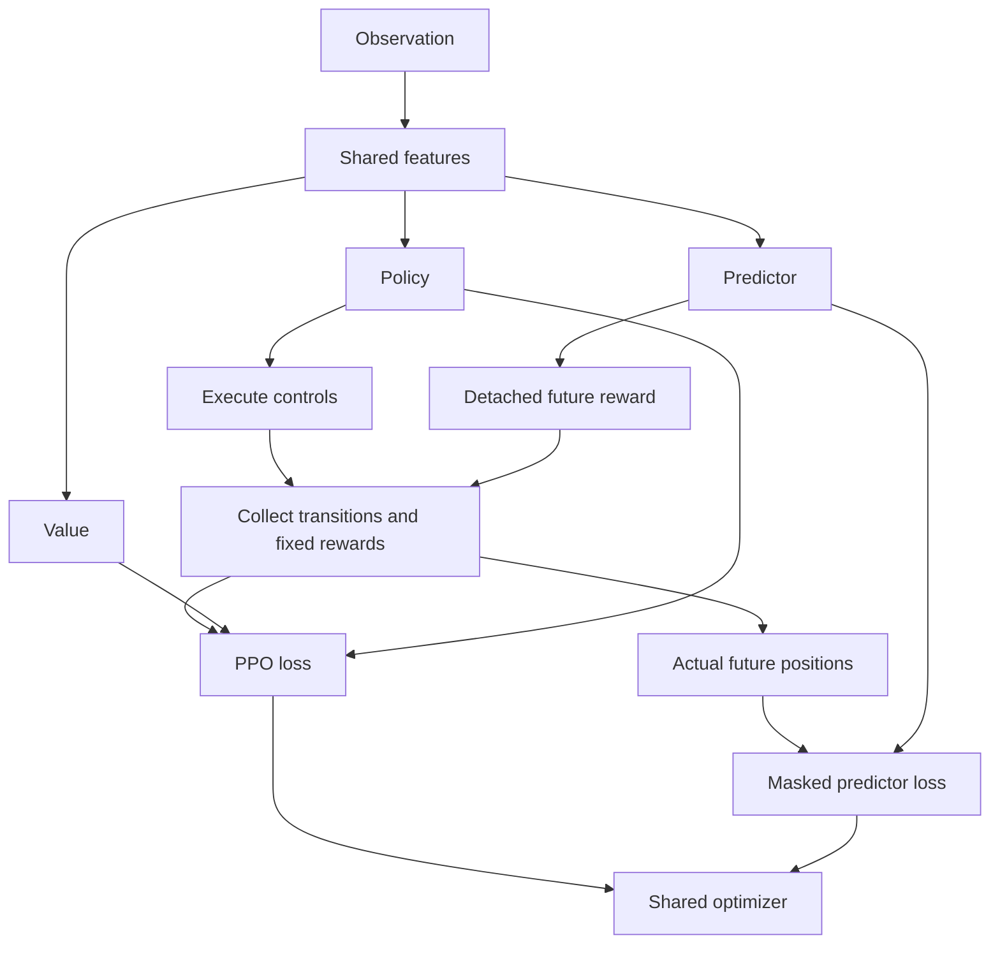

# A training step

An **environment step** produces one driving transition. A **PPO phase**
collects many transitions and then optimizes the model. The template collects
1,024 steps per phase and reuses that rollout for ten optimization epochs.

## 1. Establish an episode start

`RacingEnvironment.reset()` prepares the session and moves the vehicle to its
episode start. For stationary starts it waits for the requested pose, low
speed and neutral controls in telemetry.

Optional rolling starts use a pre-roll controller. Pre-roll is excluded from
RL experience; episode progress and timing begin when control passes to the agent.

Read [environment and resets](racing_environment.md).
Code: [RacingEnvironment](../src/assetto_corsa_ai/RacingEnvironment.py).

## 2. Observe the car and road

The AC adapters provide `TelemetryFrame` and `SimulatorStaticInfo`.
`TrackProjector` locates the car on the reference line. `ObservationBuilder`
combines vehicle dynamics, tyre slip, road geometry and current controls.

Observations retain physical units such as m/s and local waypoints in metres.
Agent-side `VecNormalize` prepares network inputs. In delta mode the current
controls retain their existing scale.

Read [observations](observation.md).
Code: [ObservationBuilder](../src/assetto_corsa_ai/observation_builder.py).

## 3. Choose controls and predict a trajectory

A shared feature extractor processes the normalized observation. Three heads
use its features:

| Head | Purpose |
| --- | --- |
| Policy | Produce a distribution over steering and longitudinal actions |
| Value | Estimate the expected future return |
| Predictor | Estimate future positions in vehicle-relative coordinates |

During training the agent samples an action from the policy distribution.
The action wrapper translates a delta action into bounded final controls.
For example, steering `0.10` plus delta `0.02` produces `0.12` if no other
limit applies. Positive longitudinal input means throttle; negative means brake.

PPO retains the original sampled action and its likelihood. The wrapper limits
the command actually executed by the simulator.

Read [controls](control.md) and [predictor](predictor.md).
Code: [policy](../src/assetto_corsa_ai/racing_policy.py) and
[action wrapper](../src/assetto_corsa_ai/action_wrapper.py).

## 4. Drive and calculate reward

The environment applies final controls, waits for the control interval and
reads the next state. It calculates actual progress, reference-line proximity
and episode termination conditions.

When enabled, an outer reward wrapper also evaluates the previously predicted
trajectory. That prediction is detached from gradient computation. The total
reward is fixed during collection and is not recalculated during optimization.

Off-track driving or insufficient progress sets `terminated`. Time and step
limits set `truncated`. Either ending applies the brake until reset.

Read [reward](reward.md) and [episode termination](termination.md).
Code: [RewardCalculator](../src/assetto_corsa_ai/reward.py) and
[FutureRewardWrapper](../src/assetto_corsa_ai/reward_wrapper.py).

## 5. Learn from the rollout

After a complete rollout, PPO calculates returns and advantages. Actual future
positions provide supervised targets for the predictor. Missing horizons and
points beyond episode boundaries are masked.

A single optimizer updates the policy, value head, predictor and shared feature
extractor from PPO loss plus weighted predictor loss. Actual future positions
supervise the predictor; they do not retroactively supply prediction rewards.

Read [predictor training](predictor.md#shared-model-and-training).
Code: [RacingPPO](../src/assetto_corsa_ai/racing_ppo.py) and
[target construction](../src/assetto_corsa_ai/predictor.py).

## 6. Save and inspect results

Callbacks write episode and update metrics to `metrics.csv`. Regular
checkpoints follow the configured number of completed PPO phases. A model
and its normalization statistics always form a pair.

Optional snapshots after each phase supply the independent diagnostics
monitor, which can inspect live driving and record complete laps for replay.

Read [run artifacts](agent_training.md#run-records-and-checkpoints) and
[diagnostics](diagnostics.md).
Code: [TrainingRunCallback](../src/assetto_corsa_ai/training_callbacks.py).
